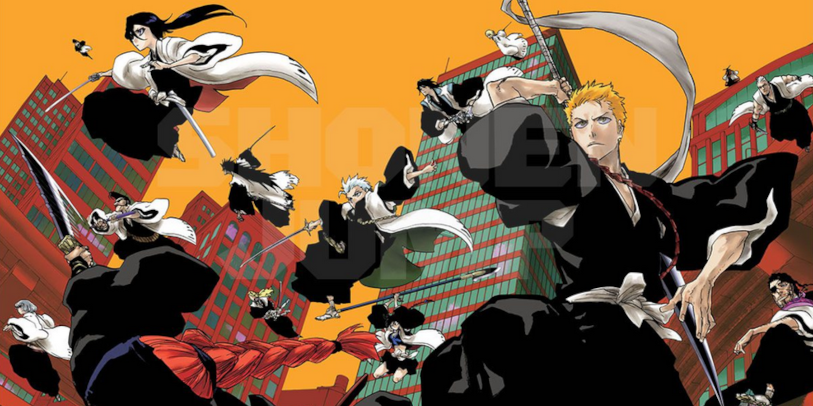
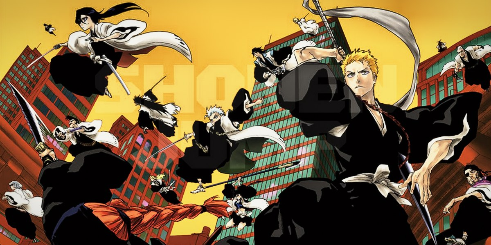

# IAQ — Image Quality

IAQ is a high-fidelity **anime image remaster engine**. It takes a low
resolution, compressed or flat-looking frame and rebuilds it at up to 8x with
clean lines, deep shadows, creamy golden highlights and smooth 8 or 16 bit
output.

This repository used to be **BXAnimator**, an Android animation editor. The
issue that renamed it asked for the remaster path only, built as a portable
`IAQ.jar`, and for the editor/legacy effects to leave the build. That is what
this tree is: one engine, one look, no dead code in the build path.

| Before (1800x900) | IAQ remaster (3600x1800, shown at 1200 px) |
| --- | --- |
|  |  |

The reference pair from the issue, the measurements and the exact tuning
decisions are in [docs/BENCHMARK.md](docs/BENCHMARK.md).

## Why a JAR instead of a native binary

The deliverable is **`IAQ.jar`**, built by `build.sh` with nothing but the JDK.

- It runs unchanged on Windows, macOS, Linux and Android/Termux with Java 17+.
  A native binary would need a build and test matrix per ABI and would not
  produce a better picture: the quality comes from the algorithm (linear-light
  Lanczos, anti-ringing, bilateral chroma denoise, CLAHE, multi-scale detail,
  filmic grade), not from the language.
- Zero runtime dependencies. No OpenCV, no native image library, no network.
- The same `float` pipeline is deterministic, so a build is reproducible.
- A JAR is also the easiest artefact to audit: one file, one manifest, no
  platform loader.

## The pipeline

Every stage is row-parallel and allocation-conscious; a 1800x900 frame becomes
3600x1800 in about 1.6 seconds on four cores.

| # | Stage | What it fixes |
| --- | --- | --- |
| 1 | Decode to **linear RGB** float | correct light maths, 16 bit input supported |
| 2 | **Lanczos-3** upscale + anti-ringing clamp | soft or blocky source, halos around ink lines |
| 3 | **Joint bilateral chroma denoise** | JPEG chroma noise, colour fringing |
| 4 | **CLAHE** on luma, shadow protected | flat lighting, weak local contrast |
| 5 | **Two-scale detail** + anti-halo clamp + line deepen | soft line art, dull texture |
| 6 | **Filmic tone curve** on luma | washed out mid-tones, grey blacks |
| 7 | **Vibrance + warm split tone + creamy highlight lift** | flat colour, cold skin, dull sky |
| 8 | **Multi-scale highlight bloom** | missing glow and lighting depth |
| 9 | **Optical vignette** | flat frame edges |
| 10 | **Triangular dither + fine grain** → 8/16 bit | banding in skies and gradients |

Alpha is filtered premultiplied, so transparent anime cut-outs keep clean
edges. JPEG output is written at quality 95; PNG output is written by IAQ's own
encoder, which is the only way to keep 16 bit precision and the dither.

## Build

```bash
bash build.sh              # tests + build/IAQ.jar
bash build.sh --tests      # JVM tests only
bash build.sh --skip-tests # JAR only
```

Requirements: JDK 17 or newer. No Gradle, no Maven, no network.

The build prints the JAR path:

```
==> built /path/to/build/IAQ.jar (40K)
JAR=/path/to/build/IAQ.jar
```

## Use

```bash
# 2x remaster, same folder, PNG
java -jar build/IAQ.jar remaster frame.png

# explicit output and a quality report
java -jar build/IAQ.jar remaster frame.png -o frame-2x.png --scale 2 --report

# 4K-wide 16 bit master
java -jar build/IAQ.jar remaster frame.jpg -o frame-4k.png --width 3840 --depth 16

# the benchmark framing: 4:3 centre crop, 2x
java -jar build/IAQ.jar remaster before.png -o after.png --scale 2 --aspect 4:3

# a folder of frames, recursive, PNG
java -jar build/IAQ.jar batch frames/ -o out/ --recursive --format png

# inspect an image without touching it
java -jar build/IAQ.jar probe frame.png
```

### Options

| Option | Meaning |
| --- | --- |
| `-o, --out PATH` | output file, or directory when several inputs are given |
| `--scale N` | upscale factor, default `2` (0.1 .. 8) |
| `--width N` | exact output width, height follows the aspect ratio |
| `--max-width N` | cap the output width, default `3840` |
| `--strength N` | remaster amount, 0 .. 1, default `1` |
| `--grain N` | fine grain, 0 .. 1, default `0.35` |
| `--depth N` | `8` or `16` bit PNG, default `8` |
| `--format png\|jpg` | inferred from `-o` otherwise |
| `--aspect W:H` | centre crop before remastering |
| `--crop X,Y,W,H` | explicit crop before remastering |
| `--no-glow` | disable the highlight bloom |
| `--no-dither` | disable the output dither |
| `--threads N` | worker threads, default all cores |
| `--report` | print before/after quality metrics |
| `--json` | one JSON object per output file |
| `--overwrite` | replace an existing output |
| `--recursive` | recurse into subdirectories (`batch`) |
| `--quiet` | only print errors |

`--strength 0.5` gives a natural, documentary remaster; `1` is the reference
look used for the benchmark; values above 0.8 are intentionally bold.

## Benchmark

The issue supplied a before/after pair and asked IAQ to match the after's
clarity, colour depth, lighting and detail. The reference is a generative
re-render (different composition, new clouds, sparks and re-drawn characters),
so a deterministic shader cannot reproduce it pixel for pixel. What it can do —
and what IAQ does — is match the *look*: golden cream sky, deep warm shadows,
crisp ink lines, glowing highlights and clean gradients.

Measured on the supplied pair (`java -jar build/IAQ.jar probe ...`):

| Image | Size | Mean luma | Contrast | Saturation | Sharpness | Clipping hi/lo |
| --- | --- | --- | --- | --- | --- | --- |
| Original | 1800x900 | 0.387 | 0.290 | 0.450 | 0.0225 | 0.17% / 2.59% |
| **IAQ 2x** | 3600x1800 | **0.387** | **0.330** | **0.573** | 0.0163 | **0.00% / 0.01%** |
| Reference render | 1200x896 | 0.364 | 0.304 | 0.452 | 0.0540 | 1.48% / 0.00% |

Sharpness is a per-pixel Laplacian mean, so it is not comparable across
different resolutions; compare the 100% crops in the benchmark document
instead. The important result is that IAQ raises contrast and colour depth
without clipping a single highlight and with only 0.01% shadow clipping, while
the reference clips 1.48% of its highlights.

### Performance

Measured on the 4 vCPU runner used to build this release:

| Job | Time |
| --- | --- |
| 1800x900 → 3600x1800, engine only | ~1.6 s |
| 1800x900 → 3600x1800, including 8 bit PNG encode | ~3.6 s |
| 1800x900 → 3600x1800, including 16 bit PNG encode | ~11 s |
| 1800x900 → 3840x1920, including 8 bit PNG encode | ~9 s |

The pipeline is O(pixels) apart from the two small Gaussian radii; the bloom
runs on a quarter-resolution copy.  The 16 bit case is dominated by writing the
33 MB PNG, not by the remaster itself.

## Tests

`bash build.sh` runs 31 checks with no test framework:

- sRGB/linear round trip, shoulder curve;
- 8 bit and 16 bit PNG encode/decode round trips;
- deterministic output across runs;
- premultiplied alpha preservation;
- aspect crop, explicit crop and exact-width output;
- contrast, saturation, sharpness and clipping behaviour;
- end-to-end `remaster`, `batch` and CLI output;
- a 1800x900 performance smoke test.

## Real-time preview

`shader/iaq_remaster.frag` is a GLSL ES 3.0 fragment shader that reproduces the
same look in one pass for a live preview or a video player. It is an
approximation of the CPU pipeline; `IAQ.jar` is the reference and the file that
is benchmarked.

## What happened to the editor

BXAnimator's Android editor, rigs, timeline, curve engine and the non-remaster
effect presets are **not part of this build**. They are preserved, untouched,
on the `legacy-bxanimator` branch and in the repository history, so nothing was
lost. The IAQ build compiles only `src/main/java/iaq` and has no Android SDK,
Gradle or APK step. If the owner wants the old tree back, it is one checkout
away; it will not slow down IAQ.

## Licence

MIT. See [LICENSE](LICENSE).
